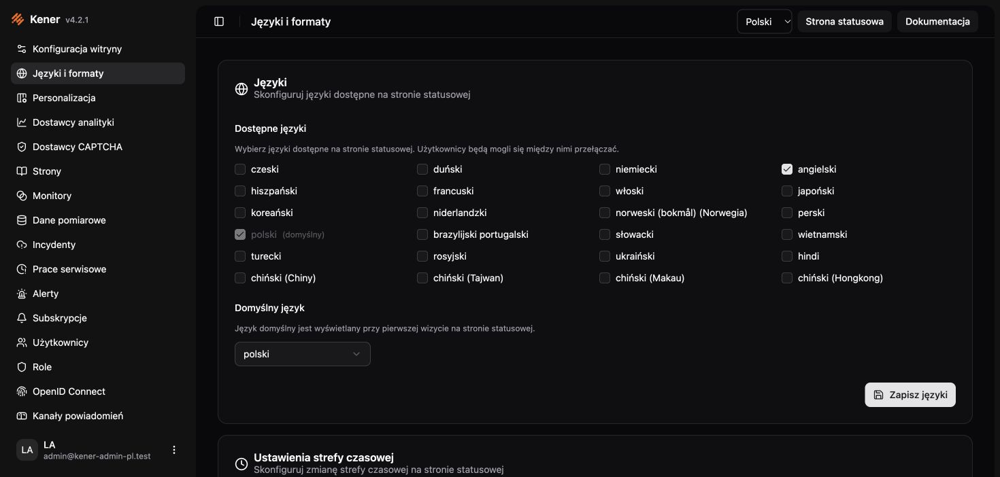
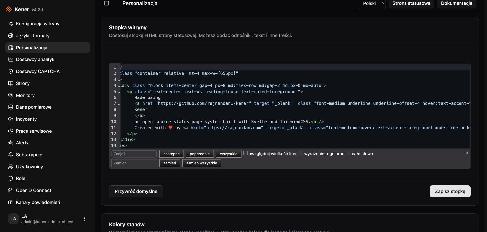
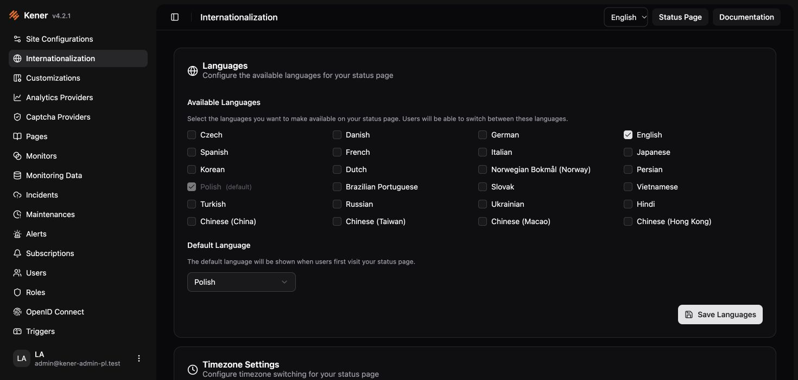

# Kener Admin PL

**Polski i czeski panel zarządzania Kenerem. English included.**

[Polski](#polski) · [English](#english) · [Instalacja](#instalacja) · [Installation](#installation)

Fork i lokalizacja: **[kgtie](https://github.com/kgtie)** · [MIT](LICENSE)

<a id="polski"></a>

## Polski

Kener Admin PL dodaje polską i czeską wersję panelu zarządzania i ekranów konta [Kenera](https://github.com/rajnandan1/kener). Przełączaj **Polski / English / Čeština** bez przeładowania strony. Zarządzaj monitorami, incydentami, pracami serwisowymi i alertami w wybranym języku.

Język panelu jest niezależny od języka publicznej strony statusowej. To pełna warstwa lokalizacji aplikacji — samo skopiowanie pliku `pl.json` do oryginalnego Kenera nie wystarczy.



### Co obejmuje lokalizacja

| Obszar             | Zakres                                                                                         |
| ------------------ | ---------------------------------------------------------------------------------------------- |
| Konto i nawigacja  | Logowanie, zaproszenia, resetowanie hasła, przełącznik PL/EN/CS i etykiety dostępności         |
| Monitoring         | Formularze 13 typów monitorów, pomiary, znane komunikaty diagnostyczne, daty i jednostki czasu |
| Komunikacja        | Incydenty i aktualizacje, prace serwisowe, alerty, kanały powiadomień i subskrypcje            |
| Administracja      | Użytkownicy, role i uprawnienia, OIDC, klucze API oraz dostawcy integracji                     |
| Wygląd i narzędzia | Strony, personalizacja, odznaki, osadzanie, szablony, wybór kolorów i polecenia edytora        |

Znane teksty są tłumaczone przy wyświetlaniu. Nazwy monitorów, własne role, treści incydentów, edytowalne wiadomości e-mail i kod zachowują swoją treść. Adresy URL, wartości API i identyfikatory protokołów pozostają niezmienione. Dokładne frazy `delete <tag>` oraz `delete <tag> data` nadal obowiązują w potwierdzeniach usuwania; ich objaśnienia są po polsku.

Język wybierasz w nagłówku panelu lub na ekranie konta. Preferencja zapisuje się na rok w cookie `kener_admin_locale`, osobno w każdej przeglądarce. Przy pierwszej wizycie panel rozpoznaje obsługiwany język przeglądarki, a w pozostałych przypadkach wybiera angielski. Ustawienia **Języki i formaty → Języki** dotyczą strony publicznej.

<details>
<summary>Polski edytor i wyszukiwanie</summary>



</details>

<a id="instalacja"></a>

### Instalacja ze źródeł

Wymagania: **Node.js 24.14 lub nowszy**, npm i działający **Redis**. Domyślną bazą jest SQLite; Kener obsługuje również PostgreSQL i MySQL/MariaDB. W razie kompilacji modułów natywnych potrzebne mogą być Python i narzędzia kompilatora.

1. Otwórz katalog pełnej kopii tego forka, zawierającej zmiany lokalizacji, i zainstaluj zależności:

    ```bash
    npm ci
    cp .env-min.example .env
    ```

2. Wygeneruj własny klucz:

    ```bash
    openssl rand -base64 32
    ```

    Wklej wynik jako `KENER_SECRET_KEY` w `.env`. Przykładowa konfiguracja lokalnej instalacji:

    ```dotenv
    KENER_SECRET_KEY=PASTE_YOUR_GENERATED_RANDOM_KEY_HERE
    ORIGIN=http://localhost:3000
    PORT=3000
    REDIS_URL=redis://127.0.0.1:6379
    DATABASE_URL=sqlite://./database/kener.sqlite.db
    ```

    Redis musi już działać pod wskazanym adresem. Dla instalacji publicznej ustaw `ORIGIN` na rzeczywisty adres HTTPS. Zachowaj ten sam klucz przy kolejnych uruchomieniach.

3. Zbuduj i uruchom aplikację:

    ```bash
    chmod 600 .env
    mkdir -p database
    npm run build
    npm start
    ```

4. Otwórz **http://localhost:3000/account/signin**, utwórz pierwsze konto administratora i wybierz język panelu.

`npm start` uruchamia pełny serwer Kenera: wykonuje migracje i inicjalizację danych, a następnie uruchamia harmonogramy i workery. Dla stałej instalacji zapewnij trwałe przechowywanie danych, kopie zapasowe, nadzór nad procesem i HTTPS. Szczegóły konfiguracji: [wdrożenie](https://kener.ing/docs/v4/setup/deployment) i [zmienne środowiskowe](https://kener.ing/docs/v4/setup/environment-variables).

**Docker:** oficjalne obrazy `rajnandan1/kener` i `ghcr.io/rajnandan1/kener` zawierają oryginalny projekt. Nasza lokalizacja wymaga zbudowania obrazu z kodu tego forka. Samo `docker compose up -d` z domyślnego pliku pobiera obraz upstreamu.

<a id="english"></a>

## English

Kener Admin PL adds Polish and Czech localization to the management panel and account screens of [Kener](https://github.com/rajnandan1/kener). Switch between **Polski / English / Čeština** instantly, without reloading the page. Manage monitors, incidents, maintenance and alerts in your preferred language.

The panel language is independent of the public status-page language. This is an application localization layer; copying `pl.json` into an unmodified Kener installation does not translate its management panel.



### Localization coverage

| Area                   | Included                                                                                  |
| ---------------------- | ----------------------------------------------------------------------------------------- |
| Account and navigation | Sign-in, invitations, password reset, PL/EN/CS selector and accessibility labels          |
| Monitoring             | Forms for 13 monitor types, measurements, known diagnostic messages, dates and time units |
| Communication          | Incidents and updates, maintenance, alerts, notification channels and subscriptions       |
| Administration         | Users, roles and permissions, OIDC, API keys and integration providers                    |
| Appearance and tools   | Pages, customizations, badges, embeds, templates, color pickers and editor commands       |

Known messages are translated at their display boundary. Monitor names, custom roles, incident content, editable email bodies and code retain their original content. URLs, API values and protocol identifiers remain unchanged. The exact confirmation phrases `delete <tag>` and `delete <tag> data` are preserved, with localized instructions.

Use the selector in the management header or on account screens. The `kener_admin_locale` cookie stores the preference for one year, separately in each browser. On a first visit, the panel follows a supported browser language and otherwise defaults to English. **Internationalization → Languages** continues to configure the public page independently.

The screenshots use a local installation with a fictional account and sample data. The English HTML in the editor screenshot is editable content, not untranslated interface text.

<a id="installation"></a>

### Install from source

Requirements: **Node.js 24.14 or newer**, npm and a running **Redis** instance. SQLite is the default database; Kener also supports PostgreSQL and MySQL/MariaDB. Python and compiler tools may be needed if native modules must be built.

1. Open the root of a full source copy of this fork containing the localization changes, then install dependencies:

    ```bash
    npm ci
    cp .env-min.example .env
    ```

2. Generate your own key:

    ```bash
    openssl rand -base64 32
    ```

    Set `KENER_SECRET_KEY` in `.env` to that output. Example configuration for a local installation:

    ```dotenv
    KENER_SECRET_KEY=PASTE_YOUR_GENERATED_RANDOM_KEY_HERE
    ORIGIN=http://localhost:3000
    PORT=3000
    REDIS_URL=redis://127.0.0.1:6379
    DATABASE_URL=sqlite://./database/kener.sqlite.db
    ```

    Redis must already be available at the configured address. For a public installation, set `ORIGIN` to its actual HTTPS URL. Keep the same secret across restarts.

3. Build and start the application:

    ```bash
    chmod 600 .env
    mkdir -p database
    npm run build
    npm start
    ```

4. Open **http://localhost:3000/account/signin**, create the first administrator account and choose the panel language.

`npm start` runs the full Kener server: database migrations and initial data setup, followed by schedulers and workers. A permanent installation also needs persistent storage, backups, process supervision and HTTPS. See the upstream [deployment guide](https://kener.ing/docs/v4/setup/deployment) and [environment variables](https://kener.ing/docs/v4/setup/environment-variables).

**Docker:** the official `rajnandan1/kener` and `ghcr.io/rajnandan1/kener` images contain the original project. Build an image from this fork's source to include the localization. Running `docker compose up -d` with the default file pulls the upstream image.

## Utrzymanie / Maintenance

Katalogi panelu / Panel catalogues: `src/lib/admin-i18n/en.json`, `pl.json` and `cs.json` — **1,932 messages per language**.

```bash
node scripts/admin-i18n/check-upstream.mjs
node scripts/admin-i18n/audit.mjs --report /tmp/kener-admin-pl-audit.json
npm run check
npm test
npm run build
```

PL: audyt sprawdza źródła tekstów, zgodność kluczy i placeholderów oraz przejrzane wyjątki techniczne. Po zmianie wersji Kenera przejrzyj różnice w panelu, ekranach konta i znanych błędach, uzupełnij wszystkie słowniki i spis `scripts/admin-i18n/source-inventory.json`, a następnie sprawdź PL/EN/CS oraz zachowanie treści użytkownika. Nie uruchamiaj builda równolegle z lokalnym Vite w tym samym katalogu — współdzielą `.svelte-kit`.

EN: the audit checks source messages, matching keys and placeholders, and reviewed technical exceptions. When updating Kener, review changes to the panel, account screens and known errors; update every catalogue and `scripts/admin-i18n/source-inventory.json`, then verify PL/EN/CS and preservation of user content. Do not run a production build alongside local Vite in the same checkout: both use `.svelte-kit`.

PL: kolejne języki są mile widziane. Dodaj katalog i jeden wpis w `src/lib/admin-i18n/languages.ts`; przełącznik, wybór języka i formatowanie dat korzystają ze wspólnego rejestru. [Instrukcja dodawania języka](<src/routes/(docs)/docs/content/v4/internationalization.md#admin-panel-contribute>). Kontrola wydania tylko odczytuje GitHub — nie aktualizuje ani nie scala kodu automatycznie.

EN: contributions in additional languages are welcome. Add a catalogue and one entry to `src/lib/admin-i18n/languages.ts`; the selector, locale resolution and date formatting follow that shared registry. [Language contribution guide](<src/routes/(docs)/docs/content/v4/internationalization.md#admin-panel-contribute>). The upstream-release check is read-only and never updates or merges code automatically.

## Projekt i licencja / Project and license

Autor i opiekun forka / Fork author and maintainer: **[kgtie](https://github.com/kgtie)**.

Kener Admin PL bazuje na / is based on [Kener](https://github.com/rajnandan1/kener), **v4.2.1** (`4079600afe3f6da59b17879df918a79932f30404`), by **Raj Nandan Sharma**.

[MIT License](LICENSE) · [Informacje licencyjne / License notices](THIRD-PARTY-NOTICES.md) · [Dokumentacja Kenera / Kener documentation](https://kener.ing/docs/v4/getting-started/introduction) · [Contributing](.github/CONTRIBUTING.md)
